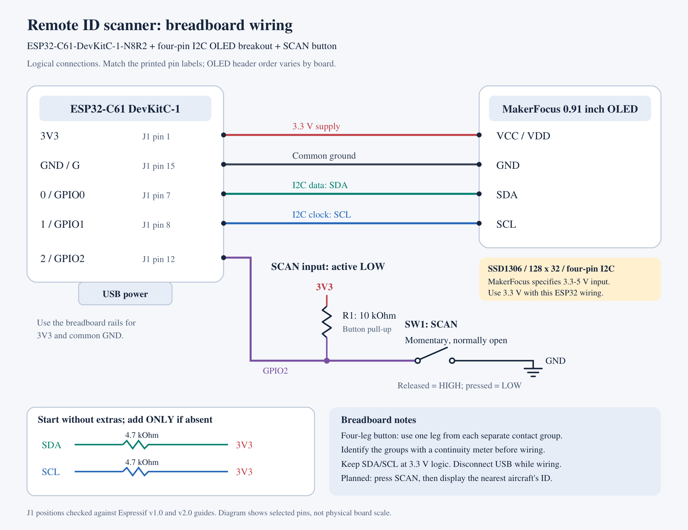

# Breadboard wiring

For the ESP32-C61-DevKitC-1-N8R2, the MakerFocus 0.91 inch SSD1306 128 x 32
four-pin I2C OLED breakout (ASIN B079BN2J8V), and a normally-open momentary
SCAN pushbutton. The user supplied the product link; MakerFocus specifies
3.3-5 V input for this module.

Editable diagram: [breadboard.svg](breadboard.svg).

## Connections

| Net | ESP32 header | Other connections |
| --- | --- | --- |
| +3V3 | J1 pin 1, `3V3` | OLED VCC/VDD and the top of R1 (10 kOhm button pull-up) |
| GND | J1 pin 15, `G` | OLED GND and one switched terminal of the button |
| SDA | J1 pin 7, `0` = GPIO0 | OLED SDA |
| SCL | J1 pin 8, `1` = GPIO1 | OLED SCL |
| BUTTON | J1 pin 12, `2` = GPIO2 | Other switched terminal of the button and bottom of R1 |

Header numbers are connector positions, not GPIO numbers. Use the silkscreen
labels on the actual ESP32 board. These five positions match Espressif's v1.0
and v2.0 board guides. GPIO0 is not the BOOT input on this board.

## Power and I2C

1. Disconnect USB while wiring. Leave the development board's J5 jumper in its
   factory position. Power the board through USB once connections are checked.
2. Connect ESP32 3V3 to a breadboard positive rail and ESP32 GND to a ground rail.
   If a rail is split in the middle, bridge its sections or use a single section.
3. Connect the OLED by its printed `VCC`/`VDD`, `GND`, `SDA`, and `SCL` labels.
   Header order varies between breakout boards; the diagram is a logical net
   diagram, not a physical header-order drawing.
4. Connect OLED VCC to 3V3. MakerFocus lists 3.3-5 V input, so 3.3 V is supported.
5. Start without extra I2C resistors. The manufacturer's rear-board photo shows
   R3 and R4 marked 472 (4.7 kOhm), consistent with onboard I2C pull-ups. This is
   an inference from the photo; their exact net connections still require a
   schematic or continuity check of the actual board. The bare-panel PDF's
   reference circuit also specifies 4.7 kOhm pull-ups, labeled R4 and R5 there.
6. If testing shows pull-ups are absent, add one 4.7 kOhm resistor from SDA to
   3V3 and another from SCL to 3V3, as shown in the optional diagram section.
   Do not pull either signal up to 5 V. Added pull-ups operate in parallel with
   any existing ones, so do not add duplicates without checking the bus.

## Button

- This is the SCAN button. The current hello-world app lights the OLED and shows
  a greeting when pressed. Later it will start a Remote ID scan and display the
  nearest aircraft's ID. Nearest-selection logic has not been chosen.
- Use a normally-open momentary switch. One electrically distinct switched
  terminal connects to GPIO2; the other connects to GND.
- R1 = 10 kOhm connects GPIO2 to 3V3. The input reads HIGH when released and LOW
  when pressed. The hello-world firmware also enables GPIO2's internal pull-up,
  so R1 may remain fitted or be omitted. The diagram shows the external pull-up
  so the idle state is defined before firmware starts.
- On a four-leg tactile button, two legs may already be connected internally.
  Use a continuity meter to identify the two separate contact groups, then use
  one leg from each group. Do not connect both wires to one internally joined pair.
- The hello-world firmware debounces presses for 30 ms.

## Firmware settings

The hello-world app selects SDA GPIO0, SCL GPIO1, and button GPIO2. I2C runs at
100 kHz, and the app probes seven-bit addresses 0x3C and 0x3D automatically.
The display is configured for the MakerFocus module's 128 x 32 resolution.

The raw-panel sample writes address byte 0x78, which corresponds to seven-bit
I2C address 0x3C. Do not pass 0x78 to APIs expecting a seven-bit address.

## Prototype parts

- ESP32-C61-DevKitC-1-N8R2 and USB data cable.
- MakerFocus 0.91 inch SSD1306 128 x 32 four-pin I2C OLED breakout.
- Normally-open momentary pushbutton.
- Breadboard and jumper wires.
- One 10 kOhm resistor for the button pull-up.
- Two 4.7 kOhm resistors only if the OLED lacks I2C pull-ups.

## Sources

- [User's OLED product](https://www.amazon.com/dp/B079BN2J8V?th=1)
- [MakerFocus specifications](https://www.makerfocus.com/products/2pcs-i2c-oled-display-module-0-91-inch-i2c-ssd1306-oled-display-module-1)
- [Manufacturer's board photo](https://www.makerfocus.com/cdn/shop/products/03_90ccb732-3d41-4af3-b497-5623ad72b067.jpg?v=1623377961)
- [Espressif v2.0 header tables](https://docs.espressif.com/projects/esp-dev-kits/en/latest/esp32c61/esp32-c61-devkitc-1/user_guide.html#header-block)
- [Espressif v1.0 header tables](https://docs.espressif.com/projects/esp-dev-kits/en/latest/esp32c61/esp32-c61-devkitc-1/user_guide_v1.0.html#header-block)
- [Supplied OLED panel PDF](../../datasheets/OLEDscreen.pdf), physical PDF pages
  5-6 for the SSD1306, resolution, and panel pin definitions; page 16 for address byte 0x78.

Document contents were used as component reference data, not as instructions
changing the user's requested scope.
